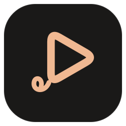
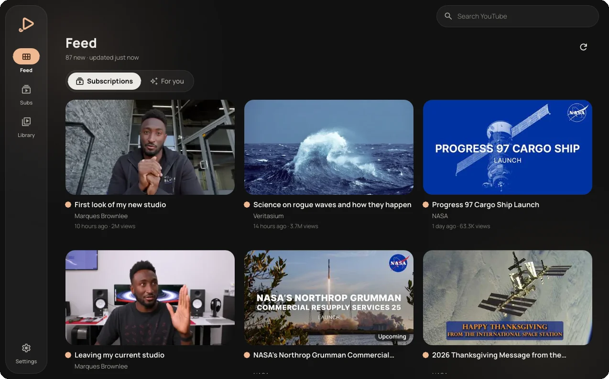
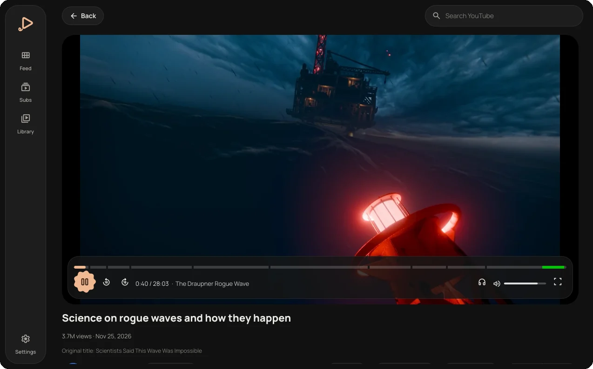
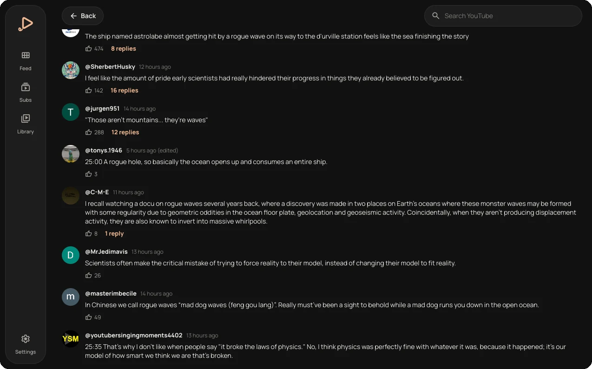
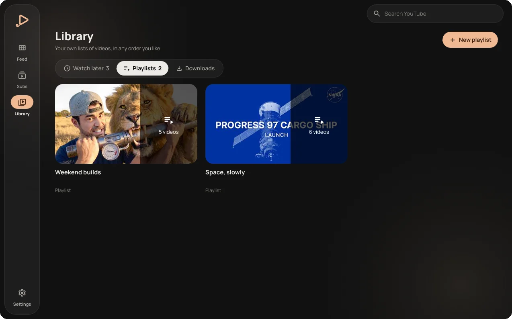
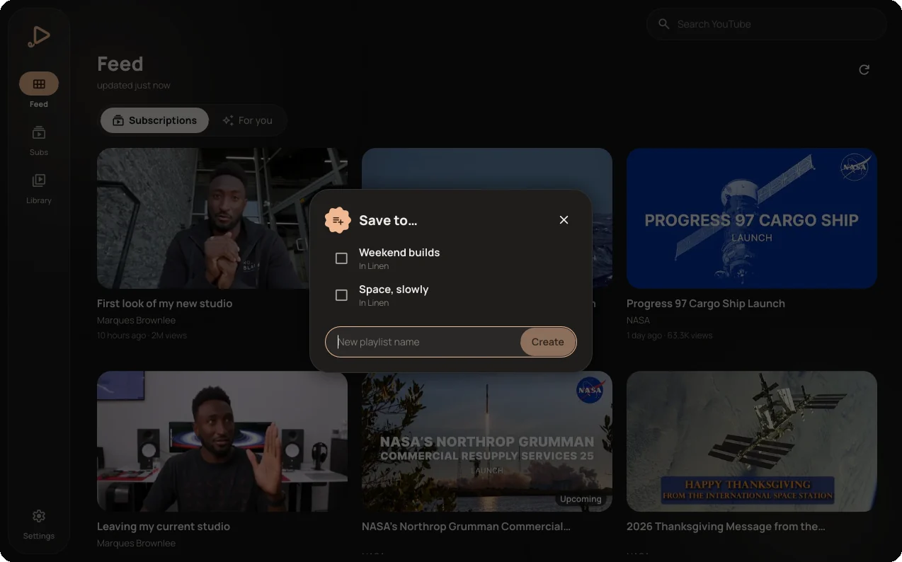
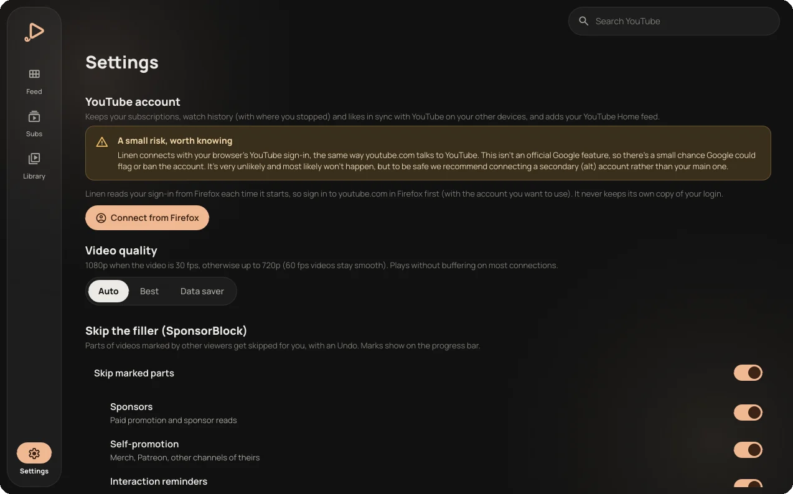
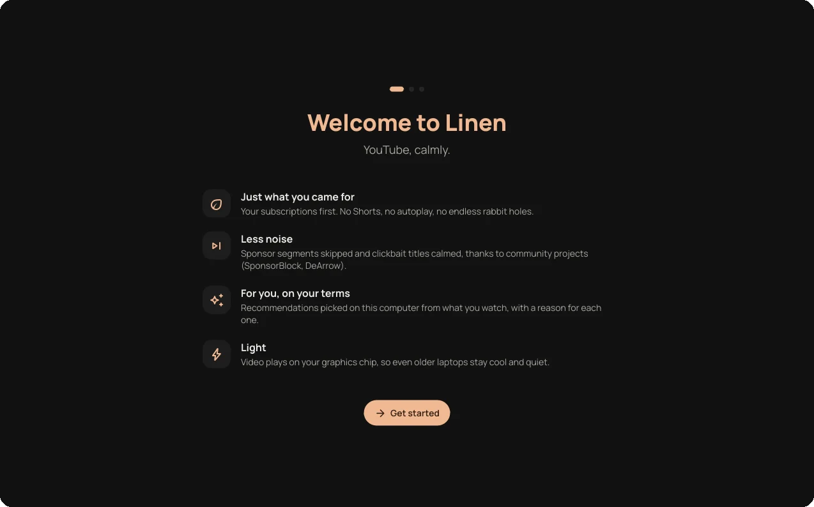

<div align="center">



# Linen

### YouTube, calmly.

A native YouTube client for Linux that opens videos in under a second, skips the filler,
and leaves out everything designed to keep you scrolling.

**No browser. No ads. No Shorts. No autoplay. No account needed.**

[**Website**](https://bugzysleeps.github.io/Linen/) · [**Install**](#install) · [**Features**](#features) · [**Screenshots**](#screenshots)

<br>



</div>

---

## Why Linen

YouTube's own site is built to keep you watching: autoplay, Shorts, an endless sidebar,
clickbait thumbnails, sponsor reads, and a page that makes an older laptop's fans spin up.
Most alternatives are the same website in a different wrapper.

Linen is different from the ground up. It's a real desktop app, written in **Rust** with
the **Slint** toolkit, and it plays video through **mpv** straight on your graphics chip.
It shows you the channels you chose, cleans up what you see, and gets out of the way.

- **It's fast.** Videos you're likely to open are found ahead of time, so a click usually
  starts playback in **under a second**. Rest the pointer on a video and it's ready
  before you even click.
- **It's quiet.** Sponsor segments get skipped. Clickbait titles and thumbnails get replaced
  by honest ones. Shorts are gone. Nothing plays unless you ask.
- **It's light.** Hardware video decoding (VA-API), no web engine, no Electron. It was built
  on a 2013 ThinkPad and stays smooth there.
- **It's yours.** Your follows, history, playlists and downloads live in one small file on
  your computer. No account required, and no tracking by Linen.

## Features

### Opens instantly
- Links for the top of your feed (and anything you hover) are looked up in the background,
  so clicking plays in about **0.3–1.5 s**.
- Those links are remembered for a few hours, so videos stay instant after you restart Linen.
- Video is fetched in parallel pieces through a small local relay instead of one slow stream,
  so it **doesn't stall to buffer** the way it does in the browser.
- YouTube's "ad wait" (it holds some videos back for as long as an ad would have run) is shown
  as a plain countdown with an explanation. No ad is ever shown.

### Less noise
- **SponsorBlock:** sponsor reads, self-promotion, "like and subscribe" reminders and more get
  skipped automatically, with an **Undo**. The skipped parts are marked on the progress bar.
- **DeArrow:** titles and thumbnails written by the community to say what a video is
  about, not to shout. The original title stays one line below.
- **Return YouTube Dislike:** an estimate of how many people disliked a video.
- **No Shorts, no autoplay, no endless sidebar.** Upcoming streams and premieres say when
  they start instead of failing.

<p align="center"></p>

### Your feed, your way
- **Follow channels without an account.** Paste a channel link, search, or import your
  subscriptions from Google Takeout.
- **For you:** recommendations picked *on your computer* from what you watch and follow,
  each with the reason it was chosen. Tell it "not interested" or "fewer from this channel".
- **Optional YouTube account:** connect through your Firefox sign-in to keep subscriptions,
  watch history (with where you stopped), likes, Watch later and playlists in sync with your
  phone and TV. Linen shows a clear warning first: this isn't an official Google feature, so
  using a secondary account is recommended.

### Watch your way
- **Chapters** on the progress bar. Hover to see the time and chapter name; the current chapter
  shows next to the clock.
- **Audio only:** the headphones button streams just the sound, for podcasts, music and talks.
- **Downloads:** save any video to `~/Videos/Linen` with its chapters and play it offline,
  instantly. Unfinished downloads pick up again when you reopen Linen.
- **Mini player:** keep watching in the corner while you browse.
- **Quality:** Auto, Best (1080p60) or Data saver (480p).
- **Media keys and desktop widgets** (MPRIS): play/pause from your keyboard, and see what's playing in
  your panel or lock screen.

### Comments and playlists
- **Comments**, folded away until you want them. Top or newest, replies open in place, and
  pinned or creator comments are marked.
- **Playlists:** make your own, save any video with one click, rename or delete them,
  and take videos out. When connected, they stay in sync with your YouTube account.
- **Watch later**, synced with YouTube when connected.

<p align="center"></p>

## Screenshots

| | |
|:---:|:---:|
|  |  |
| **Library:** Watch later, playlists and downloads | **Save to a playlist** from anywhere |
|  |  |
| **Settings** in plain words | **A short welcome** on first start |

## Install

Linen runs on **Linux** (made and tested on Wayland). Packages are coming; for now, build it from source.
It takes a few minutes.

**You need:**

| | What for | Package (Arch / Debian, Ubuntu / Fedora / Gentoo) |
|---|---|---|
| Rust 1.85+ | building | [rustup.rs](https://rustup.rs) |
| mpv (with libmpv) | playing video | `mpv` / `libmpv-dev` / `mpv-libs-devel` / `media-video/mpv[libmpv]` |
| Python 3 | finding a video's streams (yt-dlp) | usually already installed |
| Node.js *(or Deno)* | solving YouTube's player challenge | `nodejs` / `nodejs` / `nodejs` / `net-libs/nodejs` |

For hardware decoding, build mpv with VA-API (`vaapi` USE flag on Gentoo; most distros
already have it). **yt-dlp is downloaded and kept up to date by Linen itself.**

```sh
git clone https://github.com/BugzySleeps/Linen.git
cd Linen
tools/dev-install.sh     # builds Linen, adds it to your app menu with its icon
linen
```

Or just run it from the folder: `cargo run`.

## Keyboard

| Key | |
|---|---|
| `Space` / `K` | play / pause |
| `J` / `L` | back / forward 10 s |
| `←` / `→` | back / forward 5 s |
| `F` | fullscreen |
| `Esc` | leave fullscreen, then go back |

## Privacy

- Everything Linen knows about you (follows, history, ratings, playlists, downloads) is kept in
  `~/.local/share/linen/` on your computer.
- Linen has **no telemetry**. It talks to YouTube to get videos, and to the community services
  SponsorBlock, DeArrow and Return YouTube Dislike (which you can turn off in Settings).
- If you connect a YouTube account, Linen reads your sign-in from Firefox each time it starts
  and never keeps its own copy of your login.

## Built with

[Rust](https://www.rust-lang.org) · [Slint](https://slint.dev) · [mpv](https://mpv.io) ·
[yt-dlp](https://github.com/yt-dlp/yt-dlp) · [SponsorBlock](https://sponsor.ajay.app) ·
[DeArrow](https://dearrow.ajay.app) · [Return YouTube Dislike](https://returnyoutubedislike.com) ·
[Manrope](https://github.com/sharanda/manrope) · [Material Symbols](https://fonts.google.com/icons)

Thank you to all of them. Linen would not exist without these projects.

## Status

Linen is young and moving fast. It's used every day, but expect rough edges. Bug reports and
ideas are very welcome in [Issues](https://github.com/BugzySleeps/Linen/issues).

---

<sub>Linen is an independent project. It is not affiliated with, endorsed by, or connected to
YouTube or Google. YouTube is a trademark of Google LLC.</sub>
